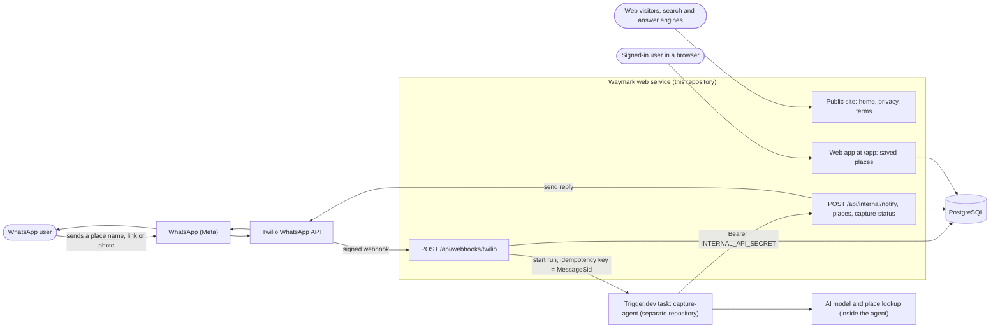
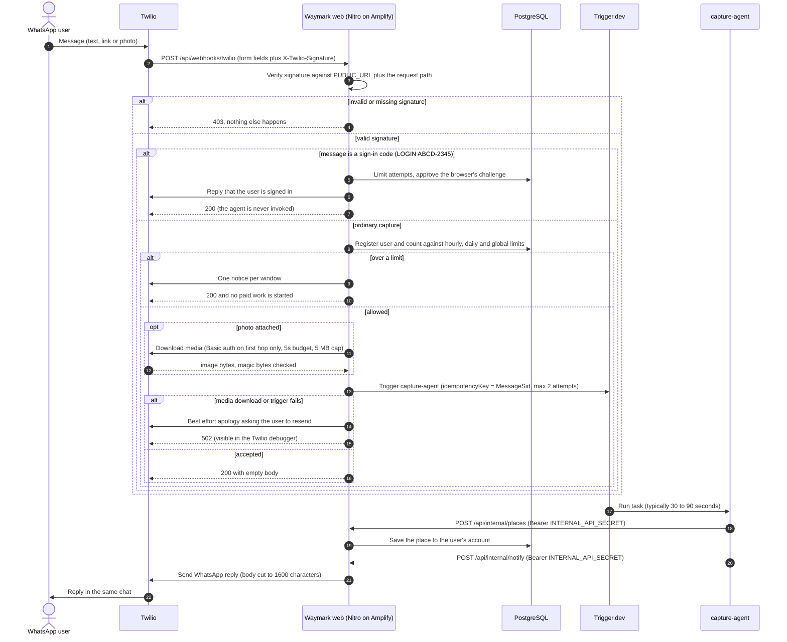
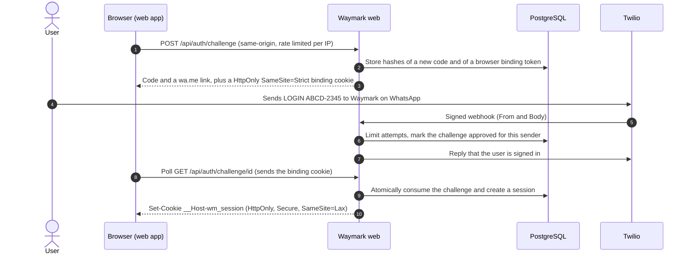
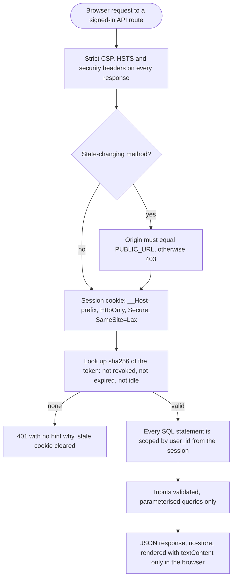
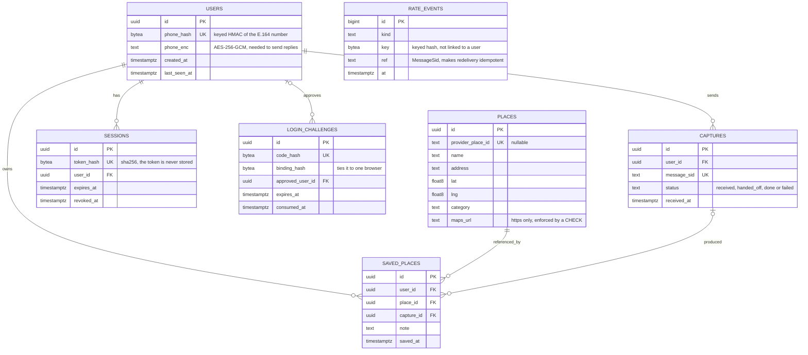
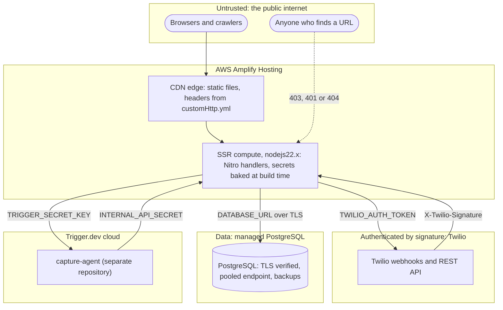

# Waymark — Architecture

**Author:** Oyugi Mourice · **Version:** 0.2.0 · **Last updated:** 2026-10-07

The single reference for how Waymark is built and why. Every behavioural claim here is backed by an automated test or
a black-box script; [`THREAT-MODEL.md`](THREAT-MODEL.md) maps each security control to its code and tests.

Related: [Build plan](BUILD-PLAN.md) · [Decisions](DECISIONS.md) · [Threat model](THREAT-MODEL.md) · [Runbook](RUNBOOK.md) ·
[Launch checklist](LAUNCH-CHECKLIST.md) · [Agent integration](AGENT-INTEGRATION.md) · [SEO & AEO](SEO-AEO.md)

---

## 1. What Waymark is

Waymark is a WhatsApp assistant for remembering places. A person sends a place name, a Google Maps link or a photo;
Waymark works out which place they mean, replies in the same chat, and keeps the place so they can find it again in a
small web app. There is no app to install and no password.

This repository is the **web service**: it receives WhatsApp messages from Twilio, enforces per-sender limits, hands the
message to an AI workflow (the separate `capture-agent` Trigger.dev task), delivers the reply, stores each user's saved
places in PostgreSQL, and serves the public website and the signed-in web app.

### Design principles

1. **Fail closed on security, fail open on availability.** Missing or malformed configuration makes protected endpoints
   refuse. A database outage, by contrast, never stops a message from being processed — accounting is skipped and logged
   ([ADR-008](DECISIONS.md#adr-008)).
2. **Authenticate everything that can cost money or touch data.** Twilio signature, shared bearer secret, or a session —
   never anything weaker.
3. **Cheapest and most restrictive first.** Signature → sign-in interception → rate limits → *then* media download and the
   paid AI run. Abuse never reaches paid work.
4. **No silent failures.** If we cannot serve a user we tell them and return an error status visible to operators.
5. **Bounded everything.** Request size, download size, every timeout, every retry and every query has an explicit limit.
6. **Least data.** The database never holds message text or photos; phone numbers are encrypted and hashed; logs mask them.
7. **Boring, verifiable tech.** Nuxt/Nitro, Zod, `pg`, plain SQL migrations, the official Twilio and Trigger.dev SDKs.

---

## 2. System context



| Actor / system | Role | Owned by |
| --- | --- | --- |
| WhatsApp user | Sends places, receives replies | End user |
| Signed-in user (browser) | Views, searches, deletes and exports their saved places | End user |
| Twilio | WhatsApp Business API provider: webhooks in, REST out | Twilio |
| **Waymark web service** | Ingress, authentication, rate limiting, storage, outbound delivery, site and web app | **This repo** |
| PostgreSQL | Users, captures, places, sessions, rate events | Managed provider |
| `capture-agent` | Asynchronous AI task that resolves the place and composes the reply | Separate repo (Trigger.dev) |

---

## 3. The message flow



### 3.1 Why the flow is asynchronous

Twilio waits **15 seconds** for a webhook; the agent needs roughly 30–90 seconds. The webhook therefore only *hands off*
and returns `200`; the agent later calls `POST /api/internal/notify` (and `/places`). Twilio credentials never leave this
service — the agent has none.

### 3.2 Time budget (worst case on the failure path)

| Step | Budget | Enforced by |
| --- | --- | --- |
| Read and verify the request | negligible | 64 KB cap checked before reading |
| Database accounting (user, limits, capture row) | **1.5 s** | `withDeadline` |
| Download the photo, all redirect hops together | **5 s** (≤ 3.5 s per hop) | `totalTimeoutMs` |
| Hand-off to Trigger.dev (2 attempts, ≤ 1 s back-off) | **3.5 s** | `withDeadline` |
| Apology to the user (failure path only) | **2.5 s** | `withDeadline` |
| Capture status update | **0.5 s** | `withDeadline` |
| **Total worst case** | **13 s** of Twilio's 15 s | tests: hung database, Trigger.dev and Twilio |

### 3.3 Failure matrix

Twilio does **not** retry an HTTP 4xx/5xx by default, so an error status alone would be a silent drop. Waymark tells the
user *and* returns an error status.

| Situation | HTTP | User sees | Operator sees |
| --- | --- | --- | --- |
| Missing / forged / tampered signature | 403 | nothing | `warn`, no PII |
| Server config missing | 500 (generic) | nothing | `error` naming the variable; `/api/ready` → 503 |
| Body larger than 64 KB | 413 | nothing | — |
| Empty message, malformed sender/SID | 200 | nothing | `warn`; no AI run |
| Sign-in message (`LOGIN …`) | 200 | "You're signed in" / "code expired" | `info`; **agent never invoked** |
| Sign-in while the database is down | 200 | "Sign-in is temporarily unavailable" | `error` |
| Over the hourly / daily / global limit | 200 | one notice per window, then silence | `warn` with reason; **no download, no AI run** |
| Photo only, photo unusable | 200 | "I couldn't read that photo…" | `warn` with reason; capture marked `failed` |
| Text **and** unusable photo | 200 | normal reply (text only) | `warn` |
| Photo download fails | 502 | "Please send it again" | `error`; capture `failed` |
| Trigger.dev fails or hangs | 502 | "Please send it again" | `error`; capture `failed` |
| **Database down or slow during accounting** | 200 (processed) | normal reply | `error: accounting unavailable` — **fail open** |
| `notify`: Twilio rejects permanently (e.g. 63016) | 422 | nothing | `error` with Twilio code |
| `notify`: rate limit / 5xx / timeout | 429 / 502 / 504 | nothing | `error` |

---

## 4. Accounts, sign-in and the web app

### 4.1 Sign-in without passwords or SMS codes



Ownership of the phone number is proven by a **Twilio-signed inbound WhatsApp message**. There is no password or OTP to
phish, no SMS-pumping surface, and no message template needed (the user's message opens the 24-hour window).
Security properties, each tested:

* The code (8 characters, ~39.6 bits, no look-alike characters) and the browser-binding token are stored **only as hashes**.
* A challenge lives **5 minutes**, is **single use**, and the session is issued **exactly once** (atomic `UPDATE … RETURNING`;
  six concurrent claims yield one session).
* Only the browser that created the challenge — holder of the `SameSite=Strict`, `HttpOnly` binding cookie — can collect
  the session, even if someone else learns the challenge id.
* Guessing over WhatsApp is limited to **10 attempts/hour/sender**; challenge creation is limited per client IP and globally.

### 4.2 Sessions and request defences



Session cookie `__Host-wm_session`: `HttpOnly; Secure; SameSite=Lax; Path=/`, 30-day absolute and 7-day idle lifetime,
revocable server-side, token stored as a SHA-256 hash. Mutating routes also require the `Origin` header to equal
`PUBLIC_URL` (CSRF), and every query is scoped by the session's `user_id` — "not yours" and "does not exist" are both `404`.

### 4.3 The web app (`/app`)

A small, dependency-free browser app served from `/app-static/` under its **own** policy: `script-src 'self'` (no inline
script, no eval, no third parties), `connect-src 'self'`, `frame-ancestors 'none'`. The public site keeps
`script-src 'none'` ([ADR-002](DECISIONS.md#adr-002), [ADR-009](DECISIONS.md#adr-009)). Everything that came from the
database or the agent is rendered with `textContent` only; links are created only from validated `https` URLs; this is
enforced by an ESLint rule, a source-scan test, and 54 client tests (a simulated browser) that feed XSS payloads through every field.

Features: sign in, list with search and pagination, open in maps, remove (two-step), **download my data**, sign out,
**delete my account** (typed confirmation). The page is never prerendered, never cached, and `noindex`.

---

## 5. Data



* A phone number is stored **twice**: a keyed HMAC (to recognise a user without reading the number) and an AES-256-GCM
  ciphertext (only because replies must be sent to it). Two different 32-byte keys; neither is the database password.
* The database holds **no message text and no photos** — a capture row records the message id, time and status only.
* `places.maps_url` is constrained to `https://` **in the database**, so even a faulty agent cannot store a `javascript:` link.
* `rate_events` is deliberately **not linked to users**, so deleting an account does not reset abuse limits; rows are
  pruned after 48 hours by hourly housekeeping triggered from real traffic.
* Erasure (`DELETE /api/me`) removes the user and everything that cascades from them, then any catalogue place nobody else
  has saved — verified for cascade, shared places, and unrelated users.
* Migrations are forward-only SQL (`db/migrations`), checksummed, serialised with an advisory lock, applied by
  `npm run db:migrate`. `/api/ready` reports not-ready until the schema reaches the version the code requires.

---

## 6. Code map

| Path | Responsibility |
| --- | --- |
| `server/api/webhooks/twilio.post.ts` | Inbound webhook: verify, sign-in, limits, hand off, failure policy |
| `server/api/internal/notify.post.ts` | Agent → user reply (bearer) |
| `server/api/internal/places.post.ts`, `capture-status.post.ts` | Agent saves a place / reports a run's outcome (bearer) |
| `server/api/auth/*` | Challenge create/poll, logout |
| `server/api/me*.ts`, `server/api/places/*` | Account, export, erasure, list, delete |
| `server/api/health.get.ts`, `ready.get.ts` | Liveness; configuration + database + schema readiness |
| `server/lib/db/*` | `pg` adapter (TLS, timeouts, transactions), migration runner, schema version |
| `server/lib/repos/*` | SQL for users, captures, places, sessions, challenges, rate limits |
| `server/lib/accounting.ts`, `login.ts` | Per-sender accounting; sign-in message handling |
| `server/lib/crypto.ts` | Phone hashing/encryption, tokens, login-code format and parsing |
| `server/lib/http.ts` | CSRF origin check, client IP, cookie names |
| `server/lib/contracts.ts` | **Wire contracts** (Zod) shared with the agent |
| `server/lib/config.ts` | Configuration rules shared by `/api/ready` and the build gate |
| `server/lib/twilio*.ts`, `deadline.ts`, `logger.ts`, `text.ts`, `housekeeping.ts`, `messages.ts`, `seo.ts` | Twilio, time budgets, PII-safe logging, text safety, retention, user-facing copy, SEO renderers |
| `server/utils/*` | Nitro auto-import wrappers: DB singleton, session/CSRF/cookie helpers, logger |
| `db/migrations/*.sql` | The schema |
| `public/app-static/*` | The web app (plain JS, own CSP) |
| `app/**` | Public site and the `/app` shell page |
| `scripts/*` | Config gate, migrations, headers, audit gate, bundle check, smoke and e2e |

---

## 7. Interface contracts

Source of truth: [`server/lib/contracts.ts`](../server/lib/contracts.ts). Copy it into the agent repository so both sides
validate the same schema. Full agent walkthrough with examples: [`AGENT-INTEGRATION.md`](AGENT-INTEGRATION.md).

### 7.1 Waymark → `capture-agent` (task payload)

```json
{
  "from": "whatsapp:+254700000000",
  "messageSid": "SM0123456789abcdef0123456789abcdef",
  "receivedAt": "2026-10-07T09:30:00.000Z",
  "text": "Cafe Javas Kampala Road",
  "image": { "data": "<base64>", "mediaType": "image/jpeg" }
}
```

`image` is optional; `mediaType` is **detected from the file's bytes**. `text` is trimmed, control characters removed,
capped at 4096. Idempotency key: `messageSid`. The payload is unchanged from v0.1 — adding fields would break a strict agent.

### 7.2 `capture-agent` → Waymark (all `Authorization: Bearer <INTERNAL_API_SECRET>`)

| Endpoint | Purpose | Notes |
| --- | --- | --- |
| `POST /api/internal/notify` | Send the WhatsApp reply | `to` must be `whatsapp:+…` (a leaked secret cannot send SMS); body cut to 1600 chars |
| `POST /api/internal/places` | **Save the identified place** to the user's account | idempotent per (user, place); `mapsUrl` must be https; coordinates range-checked; 32 KB cap |
| `POST /api/internal/capture-status` | Report `handed_off`, `done` or `failed` | `404` for an unknown message |

| Status | Meaning | What the agent should do |
| --- | --- | --- |
| `200` | Done | — |
| `400` | Invalid body | Fix the request; do not retry |
| `401` | Bad credentials | Check the secret; do not retry |
| `413` | Too large | Do not retry |
| `422` + `data.retryable=false`, `data.twilioCode` | Twilio refused permanently (e.g. **63016**: outside the 24-hour window) | Do **not** retry |
| `429`, `502`, `504` + `data.retryable=true` | Transient | Retry with exponential back-off |

---

## 8. Deployment and trust boundaries



* **Hosting:** AWS Amplify Hosting, Nitro `aws-amplify` preset, compute pinned to `nodejs22.x` (verified at build).
* **Secrets** are read at **build time** and baked into the bundle ([ADR-001](DECISIONS.md#adr-001)); the artifact is secret
  material and rotating needs a rebuild. Database keys are *data-protection* keys: losing them makes stored numbers unreadable.
* **Database:** use your provider's **pooled** endpoint. The adapter uses ≤ 3 connections per instance, verified TLS for any
  non-local host, 3 s connect and 5 s statement timeouts.
* **Headers:** SSR responses via Nitro route rules; static files via generated `customHttp.yml` (checked in CI). `/app` has
  its own policy.
* **Environments:** local (Docker Postgres + ngrok + Twilio sandbox), production (managed Postgres + approved sender).
  Never share keys between them.

---

## 9. Delivery pipeline

```mermaid
flowchart LR
  push["Push or pull request"] --> lint
  push --> cq["CodeQL"]
  push --> gl["gitleaks secret scan"]
  subgraph ci["GitHub Actions CI with a PostgreSQL service"]
    lint["lint"] --> tc["typecheck"] --> ut["unit, database, integration and client tests with coverage gate"] --> hd["headers in sync"] --> au["audit gate"] --> bd["Amplify build and bundle check"] --> mg["migrate the e2e database"] --> e2["end-to-end and smoke on the built server"]
  end
  e2 --> merge{"merge to main"}
  merge --> mig["Manual and approval-gated: db:migrate on production"]
  mig --> n
  subgraph amp["AWS Amplify build"]
    n["nvm 22 and npm ci"] --> tt["tests that need no database"] --> ce["config gate: check-env"] --> nb["nuxt build"] --> cm["check-manifest"]
  end
  cm --> live["deploy"]
  live --> sm["npm run smoke against the live URL"]
```



Every gate is a command you can run locally (`npm run verify`). Database-backed tests **fail** (not skip) when PostgreSQL
is unreachable; skipping needs an explicit `SKIP_DB_TESTS=1`, which Amplify's build container uses because it has no
database — CI is where those tests must pass.

---

## 10. Non-functional characteristics

### 10.1 Performance (measured)

| Page | HTML (Brotli) | CSS (gzip) | JavaScript |
| --- | --- | --- | --- |
| `/` | 2.0 KB | 1.7 KB | **0 KB** |
| `/privacy`, `/terms` | 1.3–1.7 KB | (shared) | **0 KB** |
| `/app` (shell) | < 1 KB | shared + 1 KB | 3 small ES modules, loaded only when signed in |

### 10.2 Availability and resilience

Idempotency on `MessageSid` (Trigger.dev, and the rate-event ref); bounded retries and deadlines everywhere; fail-open
accounting; `/api/health` and `/api/ready`; hourly retention housekeeping; per-instance connection cap. Single region.

### 10.3 Observability

One JSON object per log line with `level`, `time`, `msg`, `requestId`, `path`, plus `messageSid` and a **masked** sender.
Message text, photos, credentials, sign-in codes, session tokens and full numbers are never logged (tested). Useful
CloudWatch Logs Insights query:

```
fields @timestamp, msg, requestId, messageSid
| filter level = "error"
| sort @timestamp desc
```

Alarms: [runbook §5](RUNBOOK.md#monitoring).

### 10.4 Cost controls

Default **20 messages/hour and 100/day per sender**, plus a **5,000/day global budget**
(`RATE_LIMIT_PER_HOUR`, `RATE_LIMIT_PER_DAY`, `GLOBAL_DAILY_BUDGET`). A blocked sender is told once and no paid work
starts. Still set provider-side spend caps as a second line of defence.

---

## 11. External constraints

* **WhatsApp 24-hour window:** free-form replies only within 24 h of the user's last message; afterwards Twilio returns
  **63016** and a template is required.
* **Twilio webhook:** 15 s deadline; default retry covers connection failures only. **Body limit:** 1600 characters.
* **Production sender:** needs Meta business verification; the Twilio sandbox is not for public use.
* **Sign-in is only as strong as the user's WhatsApp account** (SIM-swap or WhatsApp takeover compromises it); mitigated by
  7-day idle expiry, revocable sessions and instant self-service erasure.
