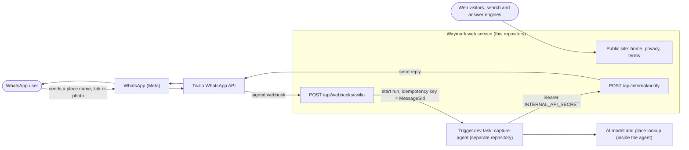
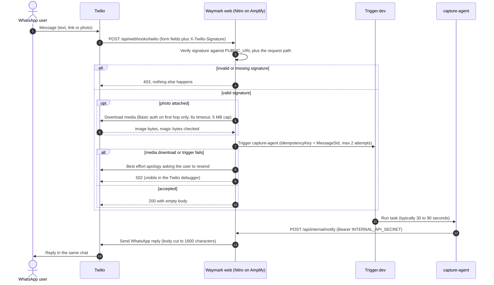
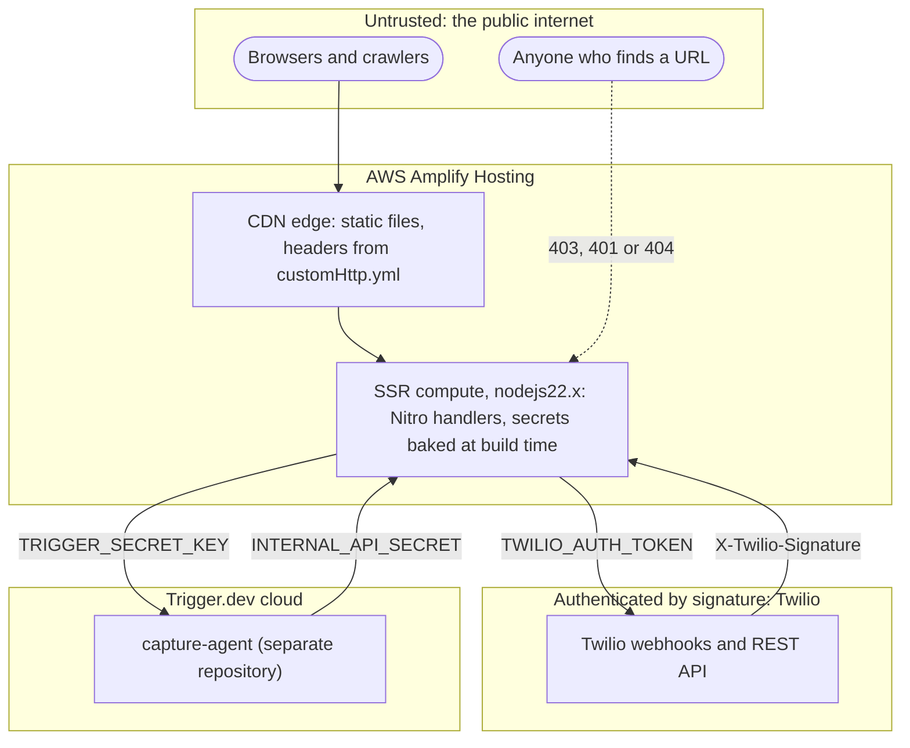
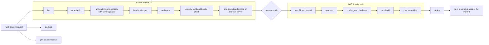
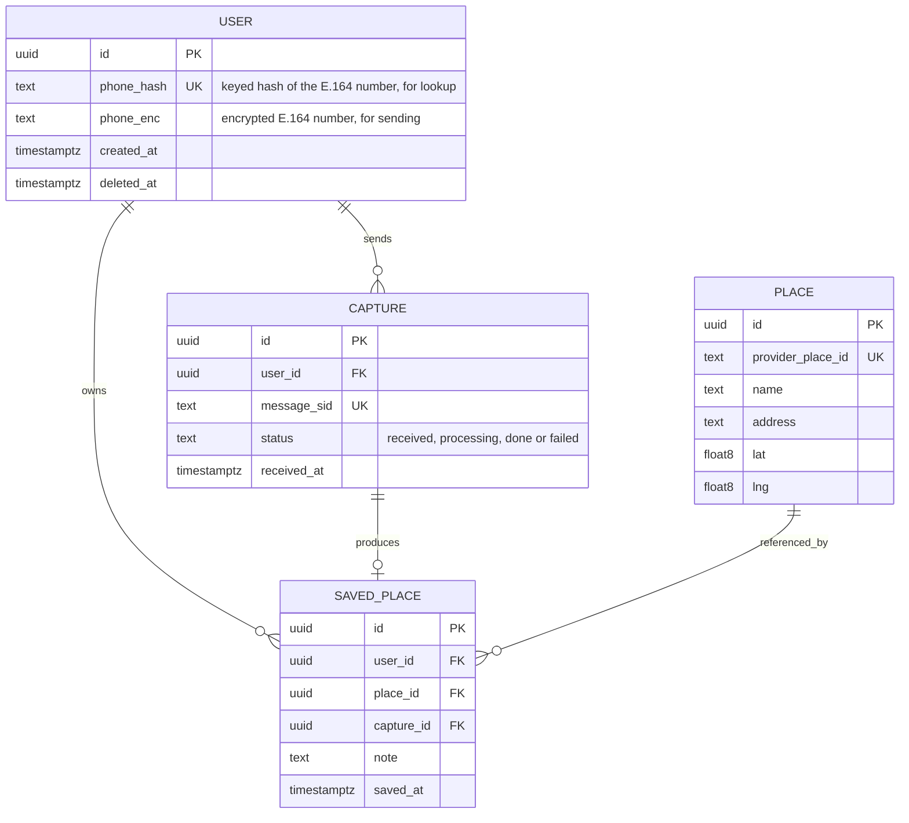
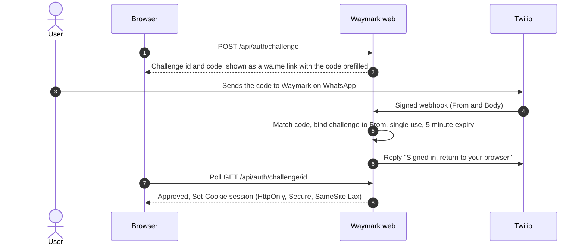

# Waymark — Architecture

**Author:** Oyugi Mourice · **Version:** 0.1.0 · **Last updated:** 2026-10-07

This is the single reference for how Waymark is built, why, and what is still to come. It is written against the code
in this repository; every claim about behaviour is backed by a test (see [`THREAT-MODEL.md`](THREAT-MODEL.md) for the
mapping). Status markers used throughout:

| Marker | Meaning |
| --- | --- |
| ✅ **Built** | Implemented in this repository and verified by tests and/or the black-box scripts. |
| 📐 **Designed** | Specified here, not implemented. Needs the stated decision before building. |

Related: [Build plan](BUILD-PLAN.md) · [Decisions](DECISIONS.md) · [Threat model](THREAT-MODEL.md) · [Runbook](RUNBOOK.md) · [Launch checklist](LAUNCH-CHECKLIST.md) · [SEO & AEO](SEO-AEO.md)

---

## 1. What Waymark is

Waymark is a WhatsApp assistant. A person sends a place name, a Google Maps link or a photo; Waymark works out which
place they mean and replies in the same chat. There is no app to install and no sign-up.

This repository is the **web service and messaging layer**: it receives WhatsApp messages from Twilio, hands them to an
AI workflow, delivers the workflow's reply, and serves the public website. The AI reasoning itself lives in a separate
Trigger.dev project (`capture-agent`) and is out of scope here.

### Design principles

1. **Stateless and thin.** The service owns no data today. It validates, hands off, and delivers.
2. **Fail closed.** Missing or malformed configuration makes protected endpoints refuse, never skip a check.
3. **Authenticate everything that can cost money.** Every route that can start an AI run or send a message is behind a
   cryptographic check (Twilio signature or a shared bearer secret).
4. **No silent failures.** If we cannot serve a user we tell them, and we return an error status so the failure is
   visible to operators.
5. **Bounded everything.** Request size, download size, every timeout and every retry count has an explicit limit.
6. **Least data.** Message content and full phone numbers never reach the logs.
7. **Boring, verifiable tech.** Nuxt/Nitro, Zod, the official Twilio and Trigger.dev SDKs; no clever infrastructure.

---

## 2. System context ✅



| Actor / system | Role | Owned by |
| --- | --- | --- |
| WhatsApp user | Sends places, receives replies | End user |
| WhatsApp (Meta) | The messaging network | Meta |
| Twilio | WhatsApp Business API provider: webhooks in, REST out | Twilio |
| **Waymark web service** | Ingress, authentication, media hand-off, outbound delivery, public site | **This repo** |
| `capture-agent` | Asynchronous AI task that resolves the place and composes the reply | Separate repo (Trigger.dev) |
| Web visitors / crawlers | Read the marketing site | Public |

---

## 3. The message flow ✅



### 3.1 Why the flow is asynchronous

Twilio waits **15 seconds** for a webhook to answer; the agent needs roughly 30–90 seconds. So the webhook only
*hands off* and returns `200` immediately, and the agent delivers its answer later through `POST /api/internal/notify`.
This is also why Twilio credentials never leave this service: the agent has no Twilio access at all.

### 3.2 Time budget (worst case on the failure path)

| Step | Budget | Enforced by |
| --- | --- | --- |
| Read and verify the request | negligible | body cap 64 KB, checked before reading |
| Download the photo (all redirect hops together) | **6 s** | `totalTimeoutMs`; per hop ≤ 4 s |
| Hand-off to Trigger.dev | **4 s** (2 attempts, ≤ 1 s back-off) | `withDeadline` |
| Apology message to the user (failure path only) | **3 s** | `withDeadline` |
| **Total worst case** | **13 s** of Twilio's 15 s | tests: hung-dependency scenarios |

### 3.3 Failure matrix

Twilio does **not** retry an HTTP 4xx/5xx by default (its default retry policy only covers connection failures), so an
error status alone would be a silent drop. Waymark therefore tells the user *and* returns an error status.

| Situation | HTTP | User sees | Operator sees |
| --- | --- | --- | --- |
| Missing / forged / tampered signature | 403 | nothing | `warn` log, no PII |
| Server config missing | 500 (generic) | nothing | `error` log naming the variable; `/api/ready` → 503 |
| Body larger than 64 KB | 413 | nothing | — |
| Empty message, or malformed sender / SID | 200 | nothing | `warn` log; no AI run is started |
| Photo only, photo unusable (too big, wrong type, gone) | 200 | "I couldn't read that photo…" | `warn` log with reason; **no AI run** |
| Text **and** unusable photo | 200 | normal reply (text only) | `warn` log with reason |
| Photo download fails (network, 5xx, bad credentials) | 502 | "Please send it again" | `error` log |
| Trigger.dev fails or hangs | 502 | "Please send it again" | `error` log |
| Both of the above, and the apology also fails | 502 | nothing | two `error` logs |
| `notify`: Twilio rejects permanently (e.g. 63016) | 422 | nothing | `error` log with Twilio code |
| `notify`: rate limit / 5xx / timeout | 429 / 502 / 504 | nothing | `error` log |

---

## 4. Code map ✅

| Path | Responsibility |
| --- | --- |
| `server/api/webhooks/twilio.post.ts` | Inbound webhook: verify, extract, hand off, failure policy |
| `server/api/internal/notify.post.ts` | Outbound reply endpoint for the agent (bearer-protected) |
| `server/api/health.get.ts`, `ready.get.ts` | Liveness and configuration readiness probes |
| `server/middleware/00.request-context.ts` | Request id (`x-request-id`) on every dynamic request |
| `server/plugins/trigger.ts` | Wires the Trigger.dev SDK to runtime config; logs config problems at start-up |
| `server/routes/robots.txt.ts`, `sitemap.xml.ts`, `llms.txt.ts` | Crawler and answer-engine surfaces (prerendered) |
| `server/utils/*` | Thin Nitro auto-import wrappers (`getLogger`, `assertInternalRequest`) |
| `server/lib/contracts.ts` | **Wire contracts** (Zod): agent payload and notify request |
| `server/lib/config.ts` | Configuration rules shared by `/api/ready` and the build gate |
| `server/lib/twilioSignature.ts` | Signature verification against the public URL |
| `server/lib/twilioMedia.ts` | Safe media download: host allow-list, SSRF guard, size cap, magic-byte check |
| `server/lib/twilioSend.ts` | Twilio sending and error classification |
| `server/lib/internalAuth.ts` | Bearer parsing and constant-time secret comparison |
| `server/lib/logger.ts` | Structured JSON logging with redaction and phone masking |
| `server/lib/text.ts`, `deadline.ts`, `seo.ts` | Grapheme-safe truncation, time budgets, SEO renderers |
| `shared/site.ts`, `shared/security.ts` | Site content (single source for page, JSON-LD and sitemap) and HTTP security headers |
| `app/**` | Public site: layout, pages, components, styles |
| `scripts/*` | Config gate, header generator, audit gate, bundle check, smoke and e2e tests |

Pure logic lives in `server/lib` with explicit imports so it is unit-testable; the Nitro handlers only wire it together.

---

## 5. Interface contracts ✅

The source of truth is [`server/lib/contracts.ts`](../server/lib/contracts.ts). Copy it into the agent repository (or
publish it as a package) so both sides validate the same schema. **Do not add payload fields without a coordinated
agent release** — the agent may parse strictly.

### 5.1 Waymark → `capture-agent` (Trigger.dev task payload)

```json
{
  "from": "whatsapp:+254700000000",
  "messageSid": "SM0123456789abcdef0123456789abcdef",
  "receivedAt": "2026-10-07T09:30:00.000Z",
  "text": "Cafe Javas Kampala Road",
  "image": { "data": "<base64>", "mediaType": "image/jpeg" }
}
```

`image` is optional. `mediaType` is the **detected** type (from the file's bytes), one of `image/jpeg`, `image/png`,
`image/webp`, `image/gif`. `text` is trimmed, control characters removed, and capped at 4096 characters.
Idempotency key: `messageSid`.

### 5.2 `capture-agent` → Waymark: `POST /api/internal/notify`

`Authorization: Bearer <INTERNAL_API_SECRET>`, body `{ "to": "whatsapp:+…", "body": "…" }`. `to` must be a WhatsApp
address (a leaked secret therefore cannot send SMS). `body` is truncated to 1600 characters on a grapheme boundary.

| Status | Meaning | What the agent should do |
| --- | --- | --- |
| `200` `{ ok, sid }` | Sent | — |
| `400` | Invalid body | Fix the request; do not retry |
| `401` | Bad credentials | Check the shared secret; do not retry |
| `413` | Request too large | Do not retry |
| `422` + `data.retryable=false`, `data.twilioCode` | Twilio refused permanently (e.g. **63016**: outside the 24-hour window) | Do **not** retry; handle the code |
| `429`, `502`, `504` + `data.retryable=true` | Transient | Retry with exponential back-off |

> **Contract change (v0.1.0):** previously every Twilio failure returned `502`. Permanent rejections are now `422`.
> An agent that treats any non-2xx as a failure keeps working unchanged; one that retries on `502` only will correctly
> stop retrying permanent errors.

---

## 6. Deployment and trust boundaries ✅



* **Hosting:** AWS Amplify Hosting, Nitro `aws-amplify` preset. Compute runtime is pinned to `nodejs22.x`
  (verified at build by `scripts/check-manifest.mjs`).
* **Secrets** are read at **build time** and baked into the server bundle ([ADR-001](DECISIONS.md#adr-001)). The built
  artifact is therefore secret material, and rotating a secret needs a rebuild.
* **Headers:** the SSR compute sets them via Nitro route rules; Amplify's CDN sets them for static files via
  `customHttp.yml`, which is generated from the same source (`shared/security.ts`) and checked in CI.
* **Environments:** local (ngrok + Twilio sandbox + Trigger dev key), production (custom domain + approved WhatsApp
  sender + Trigger prod key). Never share keys between them.

---

## 7. Delivery pipeline ✅



Every gate is a command you can run locally (`npm run verify`). Amplify re-runs the tests and the config gate, so a
deploy cannot ship with failing tests or a malformed configuration even if CI was bypassed.

---

## 8. Non-functional characteristics

### 8.1 Performance ✅ (measured on the production build)

| Page | HTML (Brotli) | CSS (gzip) | JavaScript |
| --- | --- | --- | --- |
| `/` | 2.0 KB | 1.7 KB | **0 KB** |
| `/privacy` | 1.7 KB | (shared) | **0 KB** |
| `/terms` | 1.3 KB | (shared) | **0 KB** |

Zero client JavaScript, no web fonts, no third-party requests, one cached stylesheet, an inline SVG logo. The public
pages are content, so they render fully on the server and are not hydrated. (An unreferenced client bundle is still
emitted into `static/_nuxt`; it is never loaded by these pages.)

### 8.2 Availability and resilience ✅

* Idempotency on `MessageSid` prevents duplicate paid AI runs on repeated delivery.
* Bounded retries and deadlines (§3.2) keep the webhook inside Twilio's window even when a dependency hangs.
* `/api/health` (liveness) and `/api/ready` (configuration) for the post-deploy smoke test.
* Single AWS region; cold starts add latency to the first request after idle time. Acceptable at this stage.

### 8.3 Observability ✅

Logs are one JSON object per line: `level`, `time`, `msg`, `requestId`, `path`, plus `messageSid` and a **masked**
sender (`whatsapp:+********4150`). Message text, photos, credentials and full numbers are never logged; third-party
error messages are scrubbed for embedded numbers. Useful CloudWatch Logs Insights query:

```
fields @timestamp, msg, requestId, messageSid
| filter level = "error"
| sort @timestamp desc
```

Alarm recommendations are in the [runbook](RUNBOOK.md#monitoring).

### 8.4 Cost drivers

AI runs (per message, the largest), Twilio messages, Amplify compute and data transfer. The only protection against
message flooding today is that senders must be real WhatsApp users; see residual risk **R1** in the threat model.

---

## 9. External constraints to design around

* **WhatsApp 24-hour window.** Free-form replies are only allowed within 24 hours of the user's last message. After
  that, Twilio returns error **63016** and an approved *template* is required. Anything that replies later than the
  window (retries, scheduled reminders) must account for this.
* **Twilio webhook deadline:** 15 s; default retry covers connection failures only.
* **Twilio message body limit:** 1600 characters.
* **Production WhatsApp sender** needs Meta business verification and display-name approval; the Twilio sandbox is
  for development only and is not advertised on the public site.

---

## 10. Planned architecture 📐

Everything in this section is **designed but not built**. It needs the decisions listed in
[`BUILD-PLAN.md`](BUILD-PLAN.md#decisions-needed-from-you).

### 10.1 Data model (Phase 3)



* A phone number is personal data: store a **keyed hash** (HMAC) for lookup and an **encrypted** copy only because
  replies must be sent to it. Deletion is a soft-delete followed by a hard purge job (privacy requests).
* `capture.message_sid` is unique, which makes capture creation idempotent at the data layer too.
* Recommended store: **PostgreSQL** (relational, geospatial queries later via PostGIS) reached through a serverless-safe
  pooler, because Lambda-style compute opens many short-lived connections. Alternative: DynamoDB. See
  [ADR-004](DECISIONS.md#adr-004).

### 10.2 Sign-in without passwords or SMS codes (Phase 4)



Ownership of the phone number is proven by a **Twilio-signed inbound WhatsApp message**, so there is no password, no
OTP to phish or intercept, and no template needed (the user's message opens the 24-hour window). See
[ADR-005](DECISIONS.md#adr-005).

### 10.3 Planned API surface

| Endpoint | Purpose | Auth |
| --- | --- | --- |
| `POST /api/auth/challenge`, `GET /api/auth/challenge/:id` | Start / poll WhatsApp sign-in | public, rate-limited |
| `GET /api/places`, `GET /api/places/:id` | List and read the user's places | session |
| `DELETE /api/places/:id` | Remove a place | session + CSRF protection |
| `POST /api/me/export`, `DELETE /api/me` | Data portability and erasure | session |
| `POST /api/internal/captures`, `POST /api/internal/places` | Agent writes results | bearer (internal) |

### 10.4 Security requirements for the authenticated app

* Session cookie `HttpOnly; Secure; SameSite=Lax`, short idle timeout, server-side revocation.
* A **separate, nonce-based CSP** for the app routes; the strict `script-src 'none'` policy of the public site must
  not be loosened to make room for it.
* Authorisation on every read and write by `user_id` (no object lookup by id alone).
* Shared rate limiting backed by the new data store (this also closes residual risk R1).
